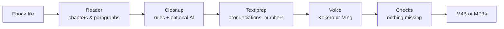

# Tomecast

**Turn ebooks into audiobooks on Linux, with natural-sounding voices that run entirely on your own computer.**

[](https://github.com/Kingskid2026/tomecast/actions/workflows/ci.yml)
[](LICENSE)

> [!NOTE]
> **Tomecast 0.1** has a desktop window and a terminal command. It turns **EPUB, DOCX, FB2, HTML and TXT** books into **M4B** audiobooks with chapters, using the Kokoro voice, on the CPU or the graphics card you already have. MP3 output, PDFs and smarter pronunciation are coming in 0.1.2. See the [roadmap](#roadmap) for what's next.

## Try it

```sh
tomecast gui                                  # the desktop window (also in your app launcher)
tomecast convert book.epub                    # writes book.m4b next to the book
tomecast convert book.docx                    # EPUB, DOCX, FB2, HTML and TXT work today (PDF in 0.1.2)
tomecast convert book.epub --voice bm_george --speed 1.1   # speed: 0.5 to 3.0 (default 1.0)
tomecast convert book.epub --format mp3       # 0.1.2: a folder "book/" with one MP3 per chapter
tomecast voices                               # list the 54 built-in voices
```

`--format mp3` writes `book/01 - Chapter title.mp3`, `02 - …` and so on, for players and car stereos that don't know `.m4b`. Each file is tagged (album, author, track n/total, chapter title) and carries the cover. MP3 is 64 kbps mono, about 29 MB per hour, the same as the M4B. Like the M4B, it never overwrites without `--force`; the window always picks a free name ("book (2)").

The first conversion downloads the voice engine, eSpeak NG and the Kokoro model (about 264 MB, after asking). On an 8-core laptop CPU, a 13-minute story took about 3 minutes to make.

If your computer has a graphics card with a working Vulkan driver (NVIDIA, AMD or Intel), Tomecast uses it automatically through the driver you already have, which was about 4 times faster on an NVIDIA laptop card (the story took 41 seconds). It downloads a different engine build for that (about 317 MB in all), never installs drivers, and falls back to the CPU if the card doesn't work. Turn it off with `--no-gpu` or the "Use graphics card" switch; `tomecast doctor` prints what Tomecast sees, for bug reports.

## What it does (and will do)

- **Reads the book, not the page.** Chapters come out as chapters. Page numbers, running headers and footers, footnote markers, copyright pages, indexes and "read the next book" previews are skipped.
- **Every sentence gets spoken.** Text is voiced in small, checked pieces, so the end of a page or chapter is never silently dropped.
- **Human-sounding, fully local voices.** [Kokoro](https://huggingface.co/hexgrad/Kokoro-82M) runs fast on any CPU. [Ming-3.0-tts](https://github.com/inclusionAI/Ming-3.0-tts) is an optional premium voice for computers with a graphics card. No cloud, no account, no subscription.
- **Many formats in:** EPUB, PDF (including scanned PDFs, with an optional AI add-on), DOCX, FB2, HTML and TXT.
- **Standard files out:** one M4B audiobook with chapter markers and cover art, or one MP3 per chapter. Play them in any audiobook app.
- **Fits the machine it's on.** On first launch, Tomecast checks the hardware and picks the right settings for a CPU-only laptop, an NVIDIA card or an AMD card. You can still switch the graphics card off.
- **Pause and resume.** Long books pick up where they left off after a crash or reboot.
- **Pronunciation fixes.** A word list for names the voice gets wrong, a finder for unusual names before you convert, and a button to hear any word right away.
- **One-line install.** It sets up its own engines and models, with no `sudo`.

## Roadmap

| Version | What's in it | Status |
|---|---|---|
| **0.1.0** | Desktop window, EPUB to M4B with chapters, the graphics card through the installed driver, speeds 0.5× to 3×, one-line install | Released |
| **0.1.1** | DOCX, FB2, TXT and HTML books, plus installer and reliability fixes | Released |
| **0.1.2** | MP3 output (one file per chapter); numbers, dates and abbreviations read properly; your own pronunciation lists, `tomecast names` and `tomecast preview`; PDF books with page numbers, headers and footnotes cleaned up | Shipping soon |
| **0.2.0** | The premium Ming voice (graphics card), a pronunciation editor in the window, the voice engine on older distros (Ubuntu, Debian), the final app icon, safer engine updates | Planned |
| **0.3.0** | Optional AI add-ons for messy books: PDF page layout, scanned PDFs (OCR), tricky cleanup calls | Planned |
| **1.0.0** | Public launch (demo, docs, install page) and a Windows version | Planned |

A Mac version isn't planned yet. Progress is tracked on the [milestones page](https://github.com/Kingskid2026/tomecast/milestones).

## How it works



The full design, including why each model and quantization was chosen, is in [docs/architecture.md](docs/architecture.md).

## Install

```sh
curl -fsSL https://raw.githubusercontent.com/Kingskid2026/tomecast/main/install.sh | sh
```

Then open **Tomecast** from your app launcher. Run the same line again any time to update. No `sudo`: the script is [short and readable](install.sh). It installs [uv](https://docs.astral.sh/uv/) if it's missing, then installs Tomecast from [PyPI](https://pypi.org/project/tomecast/) into your home folder. On first launch, Tomecast downloads only the engines and models your machine needs, and asks before downloading.

| Your system | Support |
|---|---|
| Distros with glibc 2.43 or newer: Fedora 44+, Bazzite, Arch-based ones, openSUSE Tumbleweed (check with `ldd --version`) | Everything |
| Ubuntu 22.04 and 24.04, Debian 12 and 13, Fedora 43 and older | Installs, but the voice engine needs a newer system. Planned for 0.2.0 ([#18](https://github.com/Kingskid2026/tomecast/issues/18)) |
| Alpine, NixOS, ARM computers | Not supported yet |

## Privacy

Everything runs locally. Tomecast uses the internet only to download engines and models (from their official sources, checked against pinned checksums) and for a once-a-day update check that you can turn off. There is no telemetry.

## Contributing

Contributions are welcome. Start with [CONTRIBUTING.md](CONTRIBUTING.md), and please follow the [Code of Conduct](CODE_OF_CONDUCT.md). To report a security problem, see [SECURITY.md](SECURITY.md).

## Credits and license

Tomecast's own code is licensed under the [Apache License 2.0](LICENSE). It builds on many open models and engines, each under its own license. They're listed in [THIRD_PARTY.md](THIRD_PARTY.md).
