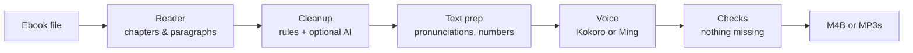

# Tomecast

**Turn ebooks into audiobooks on Linux, with natural-sounding voices that run entirely on your own computer.**

[](https://github.com/Kingskid2026/tomecast/actions/workflows/ci.yml)
[](LICENSE)

> [!NOTE]
> **Preview.** Tomecast 0.1 is a working preview, usable today. It has a desktop window and a terminal command, and turns **EPUB, PDF, DOCX, FB2, HTML and TXT** books into **M4B** audiobooks with chapters (or one MP3 per chapter), using the Kokoro voice, on your CPU or the graphics card you already have. It reads the book, not the page: page numbers, running headers, footnotes, captions, links and front matter are left out. Expect some rough edges while the rest is built. The [roadmap](#roadmap) shows what's coming next.

## Try it

```sh
tomecast gui                                  # the desktop window (also in your app launcher)
tomecast convert book.epub                    # writes book.m4b next to the book
tomecast convert book.docx                    # EPUB, PDF, DOCX, FB2, HTML and TXT work today
tomecast convert book.epub --voice bm_george --speed 1.1   # speed: 0.5 to 3.0 (default 1.0)
tomecast convert book.epub --format mp3       # a folder "book/" with one MP3 per chapter
tomecast convert book.pdf --footnotes end     # read footnotes at the end of each chapter
tomecast voices                               # list the 54 built-in voices
tomecast names book.epub                      # list names the voice might get wrong
tomecast preview "Galadriel"                  # hear a word (or -o word.wav to save it)
tomecast scan                                 # measure the speed here, retry engine updates
```

`--format mp3` writes `book/01 - Chapter title.mp3`, `02 - …` and so on, for players and car stereos that don't know `.m4b`. Each file is tagged (album, author, track n/total, chapter title) and carries the cover. MP3 is 64 kbps mono, about 29 MB per hour, the same as the M4B. Like the M4B, it never overwrites without `--force`; the window always picks a free name ("book (2)").

The first conversion downloads the voice engine, eSpeak NG and the Kokoro model (about 228 MB, after asking). On an 8-core laptop CPU, a 13-minute story took about 3 minutes to make. On a laptop running on battery, or a computer with less than 6 GB of memory, it uses half as many CPU threads, so it's slower but gentler.

If your computer has a graphics card with a working Vulkan driver (NVIDIA, AMD or Intel), Tomecast uses it automatically through the driver you already have, which was about 4 times faster on an NVIDIA laptop card (the story took 41 seconds). It downloads a different engine build for that (about 245 MB in all), never installs drivers, and falls back to the CPU if the card doesn't work. Turn it off with `--no-gpu` or the "Use graphics card" switch; `tomecast doctor` prints what Tomecast sees, for bug reports.

Before converting, Tomecast says how long the book will take on your computer, from a few-second speed test it runs once per engine build and device. When a new version of Tomecast brings a new engine build, it's downloaded beside the one you have and checked first; if it doesn't work on your computer, Tomecast keeps using the one that does and says so.

## What it does (and will do)

- **Reads the book, not the page.** Chapters come out as chapters. Page numbers, running headers and footers, footnote markers, copyright pages, indexes and "read the next book" previews are skipped.
- **Every sentence gets spoken.** Text is voiced in small, checked pieces, so the end of a page or chapter is never silently dropped.
- **Human-sounding, fully local voices.** [Kokoro](https://huggingface.co/hexgrad/Kokoro-82M) runs fast on any CPU. [Ming-3.0-tts](https://github.com/inclusionAI/Ming-3.0-tts) is an optional premium voice for computers with a graphics card. No cloud, no account, no subscription.
- **Many formats in:** EPUB, PDF (including scanned PDFs, with an optional AI add-on), DOCX, FB2, HTML and TXT.
- **Standard files out:** one M4B audiobook with chapter markers and cover art, or one MP3 per chapter. Play them in any audiobook app.
- **Fits the machine it's on.** On first launch, Tomecast checks the hardware and picks the right settings for a CPU-only laptop, an NVIDIA card or an AMD card. You can still switch the graphics card off.
- **Pause and resume.** Long books pick up where they left off after a crash or reboot.
- **Pronunciation fixes.** A word list for names the voice gets wrong, a finder for unusual names before you convert, and a button to hear any word right away.
- **One-line install.** It sets up its own engines and models, with no `sudo`.

## Saying names and numbers right

Tomecast turns numbers, dates, times, money, years, Roman numerals and abbreviations into words before the voice reads them (`Dr. Smith paid $5.50 on 4 July 1776.` becomes "Doctor Smith paid five dollars and fifty cents on the fourth of July, seventeen seventy-six."). For names and made-up words, you can tell it how to say them:

1. **Find the names.** `tomecast names book.epub` lists the capitalised words the book uses often that aren't ordinary English, with how many times (`--min-count N` and `--limit N` change what is shown).
2. **Hear them.** `tomecast preview "Galadriel"` says a word with the voice and speed you choose (`--voice`, `--speed`; `-o word.wav` saves it instead of playing it). It uses your pronunciation lists, so you hear what the book will sound like; `--raw` skips them.
3. **Fix them.** Add a line to a pronunciation list, then convert as usual.

The window does all three in one place. When a book has names like these, a **Names** step comes after Voice: press play to hear a name in the voice and speed you chose, type how it sounds, and it's saved to the book's list when you press Enter or move on (the THIS BOOK / EVERY BOOK switch moves a fix to the list for every book). TRY ANY WORD voices anything you type, with your fixes. Start converting skips the step whenever you like.

A pronunciation list is a plain text file with one fix per line, *written → say it as*:

```text
# Lines starting with # are comments, and so is anything after " #".
siobhan     → shi-vawn      # all lowercase: matches Siobhan, SIOBHAN, siobhan
Nguyen      -> win          # "->" works as well as "→"
New Zealand → noo zee-lund  # several words are fine
```

- **Two places.** `~/.local/share/tomecast/pronunciations.txt` applies to every book. A file next to the book, named like the book with `.pronunciations.txt` (`Title.epub` → `Title.pronunciations.txt`), applies to that book only and wins where the two disagree.
- **Whole words only.** `Ron` doesn't change *Ronald*. A fix written with a capital letter matches that spelling (and its ALL-CAPS form in headings), so `Mark` leaves *mark* alone.
- **The "say it as" part is a respelling**, written the way an English reader would sound it out, not a phonetic alphabet. The voice engine can't take exact phonetic spellings, so an IPA value like `/ɡəˈlædriəl/` is skipped with a warning. Hyphens make each piece its own word, and capital letters are lowercased when spoken (they only help you read the line), so try each fix with `tomecast preview` and adjust.
- A line it can't use is skipped with a note naming the line; the rest of the list still works.

## Roadmap

| Version | What's in it | Status |
|---|---|---|
| **0.1.0** | Desktop window, EPUB to M4B with chapters, the graphics card through the installed driver, speeds 0.5× to 3×, one-line install | Released |
| **0.1.1** | DOCX, FB2, TXT and HTML books, plus installer and reliability fixes | Released |
| **0.1.2** | MP3 output (one file per chapter); numbers, dates and abbreviations read properly; your own pronunciation lists, `tomecast names` and `tomecast preview`; PDF books with page numbers, headers and footnotes cleaned up | Released |
| **0.2.0** | The premium Ming voice (graphics card), a pronunciation editor in the window, the voice engine on older distros (Ubuntu, Debian), the final app icon, safer engine updates | Planned |
| **0.3.0** | Optional AI add-ons for messy books: PDF page layout, scanned PDFs (OCR), tricky cleanup calls | Planned |
| **1.0.0** | Public launch (demo, docs, install page) and a Windows version | Planned |

**What's coming, in order:**

1. **0.2.0, the polish release.** The premium Ming voice for computers with a graphics card, a pronunciation editor in the window, the voice engine on older distros such as Ubuntu and Debian (built in [#27](https://github.com/Kingskid2026/tomecast/pull/27)), the final app icon, and safer engine updates that check a new engine before switching to it.
2. **0.3.0, the AI add-ons.** Optional downloads for messy books: understanding complex PDF page layouts, reading scanned PDFs, and a small local model for tricky cleanup decisions. This is the largest piece of work, since each add-on brings its own model.
3. **1.0.0, the full release.** A Windows version, a demo, the docs, and an install page.

A Mac version isn't planned yet. Each step is tracked on the [milestones page](https://github.com/Kingskid2026/tomecast/milestones), and each version reaches you by running the install line again.

## How it works



The full design, including why each model and quantization was chosen, is in [docs/architecture.md](docs/architecture.md).

## Install

```sh
curl -fsSL https://raw.githubusercontent.com/Kingskid2026/tomecast/main/install.sh | sh
```

Then open **Tomecast** from your app launcher. Run the same line again any time to update. No `sudo`: the script is [short and readable](install.sh). It installs [uv](https://docs.astral.sh/uv/) if it's missing, then installs Tomecast from [PyPI](https://pypi.org/project/tomecast/) into your home folder. On first launch, Tomecast downloads only the engines and models your machine needs, and asks before downloading.

| Your system | Support |
|---|---|
| Ubuntu 22.04 and newer, Debian 12 and newer, Fedora 35 and newer (including Bazzite), RHEL/Alma/Rocky 9+, Arch-based ones, openSUSE Tumbleweed: anything with glibc 2.34 or newer (check with `ldd --version`) | Everything. Every engine change is tested with real conversions on Ubuntu 22.04/24.04, Debian 12/13, Fedora 43/44 and Arch |
| Older distros (Ubuntu 20.04, Debian 11, RHEL 8 and earlier) | Not supported: Tomecast's window library needs glibc 2.34 |
| Processors without AVX2 (Intel before 2013, AMD before 2015, many Pentium and Celeron chips) | Not supported yet |
| Alpine, NixOS, ARM computers | Not supported yet |

## Privacy

Everything runs locally. Tomecast uses the internet only to download engines and models, and for a once-a-day update check that you can turn off. There is no telemetry. Every download is checked against a checksum pinned in Tomecast's code. Models and most engines come from their official sources. The audio.cpp voice engine is Tomecast's own unmodified build of audio.cpp's official source, made by GitHub Actions so it runs on more distros, and downloaded from this repository's [releases](https://github.com/Kingskid2026/tomecast/releases/tag/audiocpp-v0.9.4-tc1) ([how it's built](THIRD_PARTY.md#audiocpp-builds-distributed-by-tomecast)).

## Contributing

Contributions are welcome. Start with [CONTRIBUTING.md](CONTRIBUTING.md). To report a security problem, see [SECURITY.md](SECURITY.md).

## Credits and license

Tomecast's own code is licensed under the [Apache License 2.0](LICENSE). It builds on many open models and engines, each under its own license. They're listed in [THIRD_PARTY.md](THIRD_PARTY.md).
