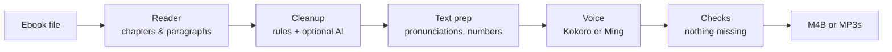

# Tomecast

**Turn ebooks into audiobooks on Linux, with natural-sounding voices that run entirely on your own computer.**

[](https://github.com/Kingskid2026/tomecast/actions/workflows/ci.yml)
[](LICENSE)

> [!WARNING]
> **Tomecast is in early development and can't convert books yet.** The design is done (see [docs/architecture.md](docs/architecture.md)), and the first usable release is tracked in the [v0.1.0 milestone](https://github.com/Kingskid2026/tomecast/milestone/1).

## What it will do

- **Reads the book, not the page.** Chapters come out as chapters. Page numbers, running headers and footers, footnote markers, copyright pages, indexes and "read the next book" previews are skipped.
- **Every sentence gets spoken.** Text is voiced in small, checked pieces, so the end of a page or chapter is never silently dropped.
- **Human-sounding, fully local voices.** [Kokoro](https://huggingface.co/hexgrad/Kokoro-82M) runs fast on any CPU. [Ming-3.0-tts](https://github.com/inclusionAI/Ming-3.0-tts) is an optional premium voice for computers with a graphics card. No cloud, no account, no subscription.
- **Many formats in:** EPUB, PDF (including scanned PDFs, with an optional AI add-on), DOCX, FB2, HTML and TXT.
- **Standard files out:** one M4B audiobook with chapter markers and cover art, or one MP3 per chapter. Play them in any audiobook app.
- **Fits the machine it's on.** On first launch, Tomecast checks the hardware and picks the right settings for a CPU-only laptop, an NVIDIA card or an AMD card. You can still switch the graphics card off.
- **Pause and resume.** Long books pick up where they left off after a crash or reboot.
- **Pronunciation fixes.** A word list for names the voice gets wrong, a finder for unusual names before you convert, and a button to hear any word right away.
- **One-line install.** It sets up its own engines and models, with no `sudo`.

## How it works



The full design, including why each model and quantization was chosen, is in [docs/architecture.md](docs/architecture.md).

## Install (planned for v0.1.0)

```sh
curl -fsSL https://kingskid2026.github.io/tomecast/install.sh | sh
```

The script is [short and readable](install.sh). It installs [uv](https://docs.astral.sh/uv/) if it's missing, then installs Tomecast from [PyPI](https://pypi.org/project/tomecast/) into your home folder. On first launch, Tomecast downloads only the engines and models your machine needs, and asks before downloading.

| Your system | Support |
|---|---|
| Ubuntu 24.04+, Fedora 40+, Arch-based, Linux Mint 22+, Debian 13+, openSUSE Tumbleweed | Everything |
| Ubuntu 22.04, Debian 12, Mint 21 | Kokoro voice and the AI add-ons. The premium Ming voice needs a newer system |
| Alpine, NixOS, ARM computers | Not supported yet |

## Privacy

Everything runs locally. Tomecast uses the internet only to download engines and models (from their official sources, checked against pinned checksums) and for a once-a-day update check that you can turn off. There is no telemetry.

## Contributing

Contributions are welcome. Start with [CONTRIBUTING.md](CONTRIBUTING.md), and please follow the [Code of Conduct](CODE_OF_CONDUCT.md). To report a security problem, see [SECURITY.md](SECURITY.md).

## Credits and license

Tomecast's own code is licensed under the [Apache License 2.0](LICENSE). It builds on many open models and engines, each under its own license. They're listed in [THIRD_PARTY.md](THIRD_PARTY.md).
