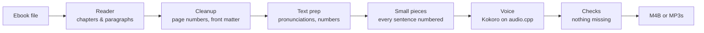

# Tomecast

**Turn ebooks into audiobooks on Linux, with natural-sounding voices that run entirely on your own computer.**

[](https://github.com/Kingskid2026/tomecast/actions/workflows/ci.yml)
[](LICENSE)

> [!NOTE]
> **Preview.** Tomecast is a working preview, usable today. It has a desktop window and a terminal command, and turns **EPUB, PDF, DOCX, FB2, HTML and TXT** books into **M4B** audiobooks with chapters (or one MP3 per chapter), using the Kokoro voice, on your CPU or the graphics card you already have. It reads the book, not the page: page numbers, running headers, footnotes, captions, links and front matter are left out. Expect some rough edges while the rest is built. The [roadmap](#roadmap) shows what's coming next.

## Install

```sh
curl -fsSL https://raw.githubusercontent.com/Kingskid2026/tomecast/main/install.sh | sh
```

Then open **Tomecast** from your app launcher, or run `tomecast --help`. Run the same line again any time to update. No `sudo`: the script is [short and readable](install.sh). It installs [uv](https://docs.astral.sh/uv/) if it's missing, installs Tomecast from [PyPI](https://pypi.org/project/tomecast/) into your home folder, and adds Tomecast to your app launcher and to the "Open with" menu for EPUB files. On first launch, Tomecast downloads only the engines and models your machine needs, and asks before downloading.

| Your system | Support |
|---|---|
| Ubuntu 22.04 and newer, Debian 12 and newer, Fedora 35 and newer (including Bazzite), RHEL/Alma/Rocky 9+, Arch-based ones, openSUSE Tumbleweed: anything with glibc 2.34 or newer (check with `ldd --version`) | Everything. Every engine change is tested with real conversions on Ubuntu 22.04/24.04, Debian 12/13, Fedora 43/44 and Arch |
| A graphics card from NVIDIA, AMD or Intel | Optional. Tomecast uses it through the Vulkan driver you already have, and never installs or changes drivers. Without one, it uses the CPU |
| Older distros (Ubuntu 20.04, Debian 11, RHEL 8 and earlier) | Not supported: the window library Tomecast uses (Qt, through PySide6) needs glibc 2.34, so Tomecast won't install there |
| Processors without AVX2 (Intel before 2013, AMD before 2015, many Pentium and Celeron chips) | Not supported yet |
| Alpine, NixOS, ARM computers | Not supported yet |
| Windows and Mac | Windows is planned for 1.0. A Mac version isn't planned yet |

The voice uses about 1.8 GB of memory while it works on the CPU. `tomecast convert` and `tomecast scan` warn you if less than 2 GB is free; the window doesn't yet.

## Try it

```sh
tomecast gui                                  # the desktop window (also in your app launcher)
tomecast gui book.epub                        # the window, with a book already open
tomecast convert book.epub                    # writes book.m4b next to the book
tomecast convert book.docx                    # EPUB, PDF, DOCX, FB2, HTML and TXT work today
tomecast convert book.epub --voice bm_george --speed 1.1   # speed: 0.5 to 3.0 (default 1.0)
tomecast convert book.epub --format mp3       # a folder "book/" with one MP3 per chapter
tomecast convert book.pdf --footnotes end     # read footnotes at the end of each chapter
tomecast voices                               # list the 54 built-in voices
tomecast names book.epub                      # list names the voice might get wrong
tomecast preview "Galadriel"                  # hear a word (or -o word.wav to save it)
tomecast doctor                               # what Tomecast sees on this computer, for bug reports
tomecast scan                                 # measure the speed here, retry engine updates
```

### The window

The window walks you through a book in a few steps:

1. **Choose a book**, or drop it on the window.
2. **Chapters:** tick the sections to convert, and choose what to leave out (page numbers, front matter, footnotes). It shows how long the audiobook will be and how long it will take to make here.
3. **Voice:** pick a voice and speed and press play to hear it, choose M4B or MP3, and switch the graphics card on or off with **Use graphics card**.
4. **Names**, when the book has unusual names: hear how each one is said, and type a fix if it's wrong (see [Saying names and numbers right](#saying-names-and-numbers-right)).
5. **Converting:** the time left and the sentence being spoken. You can pause, resume or cancel.
6. **Done:** every sentence checked, and a button to open the folder.

The window never overwrites a file: it picks a free name ("book (2)").

### Commands

| Command | What it does |
|---|---|
| `tomecast convert BOOK` | Makes the audiobook. `-o PATH` sets where it goes, `--format mp3` makes one MP3 per chapter, `--voice NAME` and `--speed N` (0.5 to 3.0) change the voice, `--gpu` or `--no-gpu` turns the graphics card on or off, `-y` downloads without asking, and `-f` overwrites an existing file |
| `tomecast convert` cleanup options | `--keep-page-numbers` reads page numbers and running headers and footers (PDF), `--keep-front-matter` reads the title page, copyright, contents, index, "Also by" lists and previews of other books, and `--footnotes end` reads footnotes at the end of their chapter (the default, `drop`, leaves them out) |
| `tomecast gui [BOOK]` | Opens the window, optionally with a book |
| `tomecast voices` | Lists the 54 Kokoro voices, by language |
| `tomecast names BOOK` | Lists the names and unusual words in a book, with how many times each is used (`--min-count N`, `--limit N`) |
| `tomecast preview TEXT` | Says a word or sentence with your pronunciation fixes (`--voice`, `--speed`, `--book BOOK` for that book's list, `--raw` for none, `-o FILE.wav` to save it) |
| `tomecast doctor` | Prints the distro, glibc, memory, power, graphics cards and installed engines, for bug reports |
| `tomecast scan` | Checks this computer again: retries engine updates that failed here before (after installing a graphics driver, say), and measures how fast it voices on the CPU and the graphics card (`--no-gpu` skips the card) |
| `tomecast desktop-entry install` | Adds Tomecast to your app launcher, if the installer couldn't (`uninstall` removes it) |

`--format mp3` writes `book/01 - Chapter title.mp3`, `02 - …` and so on, for players and car stereos that don't know `.m4b`. Each file is tagged (album, author, track n/total, chapter title) and carries the cover. MP3 is 64 kbps mono, about 29 MB per hour, the same as the M4B. Like the M4B, it never overwrites without `--force`, not even something that appears there while the book is being made (another run's book, say): the command stops with an error instead, and keeps the voiced audio, so running it again with another `-o` is quick.

If a conversion stops (you press Ctrl-C, or the computer crashes), run the same command again: it picks up where it left off.

### Speed, and your graphics card

The first conversion downloads the voice engine, eSpeak NG and the Kokoro model (about 227 MB, after asking). On an 8-core laptop CPU, a 13-minute story took about 3 minutes to make.

If your computer has a graphics card with a working Vulkan driver (NVIDIA, AMD or Intel), Tomecast uses it automatically through the driver you already have, which was about 4 times faster on an NVIDIA laptop card (the story took 41 seconds). It downloads a different engine build for that (about 244 MB in all), never installs drivers, and falls back to the CPU if the card doesn't work. Turn it off with `--no-gpu` or the **Use graphics card** switch. If the card runs out of memory partway through a book (another program is using it, say), or stops working (its driver resets it, or crashes), Tomecast carries on from that piece on the CPU, with the same voice, and tells you. Nothing is skipped, and the next book tries the card again.

Tomecast checks the computer each time it voices. On a laptop running on battery, or a computer with less than 6 GB of memory, it uses half as many CPU threads, so it's slower but gentler. `tomecast doctor` shows the thread count and why.

Before converting, Tomecast says how long the book will take on your computer, from a few-second speed test it runs once per engine build and device.

### Safe engine updates

When a new version of Tomecast brings a new voice engine build, it's downloaded beside the one you have and checked on your computer with one test sentence before Tomecast switches to it. If the check fails, Tomecast keeps using the build that works and says so in one sentence. If a new build passes the check but then fails on the first book it makes, Tomecast goes back to the previous build; run the same command again (or start again in the window) to make the book. A build that failed is tried again after 3 days, after the next Tomecast update, or when you run `tomecast scan`.

## What it does (and will do)

- **Reads the book, not the page.** Chapters come out as chapters. Page numbers, running headers and footers, footnote markers, copyright pages, indexes and "read the next book" previews are skipped.
- **Every sentence gets spoken.** Text is voiced in small, checked pieces, so the end of a page or chapter is never silently dropped.
- **Human-sounding, fully local voices.** [Kokoro](https://huggingface.co/hexgrad/Kokoro-82M) runs fast on any CPU. [Ming-3.0-tts](https://github.com/inclusionAI/Ming-3.0-tts), an optional premium voice for computers with a graphics card, is coming. No cloud, no account, no subscription.
- **Many formats in:** EPUB, PDF, DOCX, FB2, HTML and TXT. Scanned PDFs are coming, with an optional AI add-on.
- **Standard files out:** one M4B audiobook with chapter markers and cover art, or one MP3 per chapter. Play them in any audiobook app.
- **Fits the machine it's on.** Tomecast uses the graphics card when there's one it can use, and fewer CPU threads on battery or with little memory. It tells you how long a book will take before you start.
- **Safe updates.** A new voice engine is checked on your computer before Tomecast switches to it, and Tomecast goes back to the old one if the new one fails.
- **Pause and resume.** Long books pick up where they left off after a crash or reboot.
- **Pronunciation fixes.** A Names step in the window, a word list for names the voice gets wrong, a finder for unusual names before you convert, and a way to hear any word right away.
- **One-line install.** It sets up its own engines and models, with no `sudo`.

## Saying names and numbers right

Tomecast turns numbers, dates, times, money, years, Roman numerals and abbreviations into words before the voice reads them (`Dr. Smith paid $5.50 on 4 July 1776.` becomes "Doctor Smith paid five dollars and fifty cents on the fourth of July, seventeen seventy-six."). For names and made-up words, you can tell it how to say them:

1. **Find the names.** `tomecast names book.epub` lists the capitalised words the book uses often that aren't ordinary English, with how many times (`--min-count N` and `--limit N` change what is shown).
2. **Hear them.** `tomecast preview "Galadriel"` says a word with the voice and speed you choose (`--voice`, `--speed`; `-o word.wav` saves it instead of playing it). It uses your pronunciation lists, so you hear what the book will sound like; `--book book.epub` adds that book's list, and `--raw` skips them all.
3. **Fix them.** Add a line to a pronunciation list, then convert as usual.

The window does all three in one place. When a book has names like these, a **Names** step comes after Voice: press play to hear a name in the voice and speed you chose, type how it sounds, and it's saved to the book's list when you press Enter or move on (the THIS BOOK / EVERY BOOK switch moves a fix to the list for every book). TRY ANY WORD voices anything you type, with your fixes. You don't have to fix anything: Start converting goes on whenever you like.

A pronunciation list is a plain text file with one fix per line, *written → say it as*:

```text
# Lines starting with # are comments, and so is anything after " #".
siobhan     → shi-vawn      # all lowercase: matches Siobhan, SIOBHAN, siobhan
Nguyen      -> win          # "->" works as well as "→"
New Zealand → noo zee-lund  # several words are fine
```

- **Two places.** `~/.local/share/tomecast/pronunciations.txt` applies to every book. A file next to the book, named like the book with `.pronunciations.txt` (`Title.epub` → `Title.pronunciations.txt`), applies to that book only and wins where the two disagree.
- **Whole words only.** `Ron` doesn't change *Ronald*. A fix written with a capital letter matches that spelling (and its ALL-CAPS form in headings), so `Mark` leaves *mark* alone.
- **The "say it as" part is a respelling**, written the way an English reader would sound it out, not a phonetic alphabet. The voice engine can't take phonetic spellings (it would read the symbols out by name), so a line written in IPA is skipped with a note, and the window won't save one. That means IPA symbols, such as IPA letters (`ɡəˈlædriəl`), stress and length marks (`gal-ˈad-ree-el`) and the Greek letters IPA uses (`θ`), with or without slashes or brackets around them. It also means eSpeak's `[[…]]` markup, and plain letters in slashes or brackets (`[gal-AD-ree-el]`): leave those out. Accented letters, the ʻokina and the apostrophes of transliterated names are fine (`Zoë`, `Hawaiʻi`, `Qurʾān`), and apostrophe look-alikes such as ʼ count as apostrophes on both sides, so a fix for `Siobhan` also covers *Siobhanʼs*. Hyphens make each piece its own word, and capital letters are lowercased when spoken (they only help you read the line), so try each fix with `tomecast preview` and adjust.
- A line it can't use is skipped with a note naming the line; the rest of the list still works.

## How it works



1. A **reader** for each format turns the book into chapters and paragraphs.
2. **Cleanup** rules leave out what isn't the book: page numbers, running headers, footnotes, front and back matter.
3. **Text prep** turns numbers, dates and abbreviations into words, and applies your pronunciation lists.
4. The text is cut into **small pieces** of a sentence or less (at most 200 characters), and every piece gets a number. Tomecast checks that the pieces hold every character of the text.
5. The **voice** is Kokoro, running in [audio.cpp](https://github.com/0xShug0/audio.cpp) on the CPU or the graphics card. Each piece's audio is **checked**: a piece that's silent or too short for its text is voiced again, and if it still fails, the conversion stops with an error instead of leaving a gap.
6. The pieces are joined into an **M4B** with chapter markers and the cover, or into one **MP3** per chapter.

The full design, including why each model and quantization was chosen, is in [docs/architecture.md](docs/architecture.md).

## Roadmap

| Version | What's in it | Status |
|---|---|---|
| **0.1.0** | Desktop window, EPUB to M4B with chapters, the graphics card through the installed driver, speeds 0.5× to 3×, one-line install | Released |
| **0.1.1** | DOCX, FB2, TXT and HTML books, plus installer and reliability fixes | Released |
| **0.1.2** | MP3 output (one file per chapter); numbers, dates and abbreviations read properly; your own pronunciation lists, `tomecast names` and `tomecast preview`; PDF books with page numbers, headers and footnotes cleaned up | Released |
| **0.2.0** | The voice engine on more distros (Ubuntu 22.04 and 24.04, Debian 12 and 13, Fedora 43) through Tomecast's own audio.cpp build; the Names step in the window; the final app icon; safe engine updates with a self-check, rollback and a speed test with time estimates; fewer threads on battery or low memory; `tomecast doctor` and `tomecast scan`; carrying on on the CPU when the graphics card runs out of memory or stops working; PDF ligatures and IPA-free pronunciation lists | Released |
| **0.2.x** | The premium Ming voice, for computers with a graphics card | Next |
| **0.3.0** | Optional AI add-ons for messy books: PDF page layout, scanned PDFs (OCR), tricky cleanup calls | Planned |
| **1.0.0** | Public launch (demo, docs, install page) and a Windows version | Planned |

**What's coming, in order:**

1. **0.2.0, the polish release.** Everything in its row above is built.
2. **The premium Ming voice**, for computers with a graphics card. It's being tested now, and comes in a 0.2.x release once it's ready.
3. **0.3.0, the AI add-ons.** Optional downloads for messy books: understanding complex PDF page layouts, reading scanned PDFs, and a small local model for tricky cleanup decisions. This is the largest piece of work, since each add-on brings its own model.
4. **1.0.0, the full release.** A Windows version, a demo, the docs, and an install page.

A Mac version isn't planned yet. Each step is tracked on the [milestones page](https://github.com/Kingskid2026/tomecast/milestones), and each version reaches you by running the install line again.

## Privacy

Everything runs locally. Tomecast uses the internet only to download engines and models, after asking. It doesn't check for updates on its own: run the install line again to update. There is no telemetry. Every download is checked against a checksum pinned in Tomecast's code. Models and most engines come from their official sources. The audio.cpp voice engine is Tomecast's own build of audio.cpp's official source, made by GitHub Actions so it runs on more distros, and downloaded from this repository's [releases](https://github.com/Kingskid2026/tomecast/releases/tag/audiocpp-v0.9.4-tc1) ([how it's built](THIRD_PARTY.md#audiocpp-builds-distributed-by-tomecast)). Its only source changes are small opt-in patches of Tomecast's own, listed there, which do nothing unless turned on.

## Contributing

Contributions are welcome. Start with [CONTRIBUTING.md](CONTRIBUTING.md). To report a security problem, see [SECURITY.md](SECURITY.md).

## Credits and license

Tomecast's own code is licensed under the [Apache License 2.0](LICENSE). It builds on many open models and engines, each under its own license. They're listed in [THIRD_PARTY.md](THIRD_PARTY.md).
